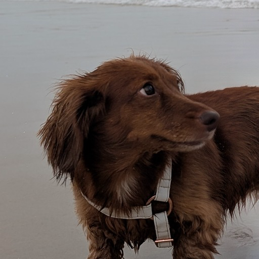

# Extremely Long Dog (XLONGDOG)



Extremely Long Dog ($XLONGDOG): the longest dog on Robinhood Chain. A community meme token for the extremely long dog from @taylor_'s viral post. Unofficial fan meme, not affiliated with or endorsed by the post's author. Website: https://midaswhale.wtf/xlongdog | Source post: https://x.com/taylor_/status/2120975103148359750

Website / external URL: **https://midaswhale.wtf/xlongdog**

X / source post: **https://x.com/taylor_/status/2120975103148359750**.
This link identifies the source post only; it is not an official project account of @taylor_.

This repository delivers the standard IMD `evm_project` token-only build for Robinhood
Chain (4663). The sole production contract is [`LaunchToken`](src/LaunchToken.sol).
Deployment is performed by IMD after acceptance, manifest preparation and independent review.
No transaction has been broadcast by this project.

## Token behavior

`LaunchToken` is an unmodified OpenZeppelin ERC-20 with a constructor that fixes the
name and symbol and mints exactly **1,000,000,000 tokens with 18 decimals**
(`1000000000000000000000000000` minor units) to `msg.sender`, the deploying factory.
The constructor is nonpayable and takes **no arguments**. It calls no external contract
and works on an otherwise empty chain.

The only state-changing runtime functions are `transfer`, `approve`, and `transferFrom`.
There is no additional minting, burning entrypoint, tax, pause, blocklist, max-buy,
max-wallet, cooldown, owner, rescue, upgrade, custom hook or application contract.
The launch owner has no privileges over holder balances. Transfers deliver exactly the
requested amount; zero transfers and self-transfers use standard ERC-20 behavior.
Transfers to the zero address and approvals to the zero spender revert. Failed transfers
leave both balances and allowances unchanged. Infinite approvals follow OpenZeppelin's
standard behavior and are not decremented; finite allowances are consumed.

The token has no payable entrypoints or withdrawal function. Tokens sent to the token
contract itself cannot be recovered. Users control their own allowances and should revoke
unneeded approvals; replacing a nonzero allowance has the usual ERC-20 approval ordering risk.

## Deployment handoff

These values are fixed by this assignment. They are handoff data for the separate manifest
step; this repository intentionally contains no `launch.json`.

| Field | Required value |
| --- | --- |
| Launch kind | `evm_project`, token-only |
| Network / chain ID | Robinhood Chain / `4663` |
| Token artifact | `src/LaunchToken.sol:LaunchToken` |
| Token constructor arguments | `[]` |
| Application contracts | `[]` |
| Name / symbol / decimals | `Extremely Long Dog` / `XLONGDOG` / `18` |
| Supply in minor units | `1000000000000000000000000000` |
| `economics.poolBps` | **`9000`** |
| Swarm share | `1000` basis points of total supply |
| Requester's direct token allocation | `0` (all of the requester's 90% seeds the pool) |
| Launch owner (`$owner`) | `0xca8cf9081bde61a773fb0c03c8137606a06ed63d` |
| `pool.pairedCurrency` | `0x0000000000000000000000000000000000000000` — the policy's native ETH sentinel |
| `pool.fee` | **`12500` (1.25%)** |
| `pool.tickSpacing` | `60` |
| `pool.initialPrice` | `"79228162514264337593543950336"` |
| Policy opening market cap | `10 ETH` for the whole supply |
| Website / external URL | `https://midaswhale.wtf/xlongdog` |
| X / source post | `https://x.com/taylor_/status/2120975103148359750` |
| Metadata / logo | `metadata/token.json` / `assets/logo.png` |

The factory receives the full supply, then allocates **900,000,000 XLONGDOG to the
pool** and **100,000,000 XLONGDOG to its MerkleDistributor** for the swarm. The swarm's
share comprises 2% of total supply for accepted contributors and 8% for paired seats,
as calculated by IMD. No swarm wallet, extra allocator or distributor is deployed here.
The factory supplies the LP and initialization-only guard. There are no custom swap callbacks.

The policy's pool fee is 1.25% per trade: 1% for the wallet that paid for the launch
and 0.25% for IMD, claimable for their beneficiaries under the launch protocol.
This pool fee is outside the token; ordinary ERC-20 transfers have zero tax.
The supplied launch owner is protocol handoff data, not a role in `LaunchToken`.

The manifest's initial-price value is the required legacy value. The deployer derives
the effective opening price from the policy's 10 ETH opening cap and the deployed token
address. The factory seeds the pool with launch tokens only. Do not assume an ETH
deposit or a 1:1 execution price. Use the exact `poolKey` from the eventual deployment
handoff, including the protocol guard; do not guess currency ordering, addresses or salts.

## Metadata and logo

[`metadata/token.json`](metadata/token.json) contains the exact official name, symbol,
description, 18 decimals, website (`external_url`, `website`, and `links.website`), and
source-post X link. Its `image` is a self-contained `data:image/png;base64,...` URI encoding
the delivered [`assets/logo.png`](assets/logo.png). It needs no image host and does not
claim a new URL exists. The token exposes standard ERC-20 name/symbol/decimals only;
there is no `contractURI` or metadata administration on chain.

The logo is an **opaque RGB 512×512 PNG**, a square crop of the exact supplied
[first photograph](https://pbs.twimg.com/media/HW83ZHFWEAAKK_C.jpg). The dog's face sits
inside the central circle for wallet cropping. There is no redrawing, text, ticker,
border, transparency, frame or stylization. The original photograph, crop coordinates,
checksums and reproduction command are recorded in [`assets/README.md`](assets/README.md).

For explorer and wallet submissions, use the exact bio above, the official website,
the source post as X (with the source-only disclaimer), and the PNG file. If a service
requires an HTTPS image URL instead of an upload or data URI, the website operator must
publish this exact PNG and use the resulting confirmed URL. Preserve the official website
in every website / links field. Do not substitute the author's account for a project account.

## Build and check

All Solidity dependencies are vendored as ordinary files under `lib/`, including their
licenses; there are no submodules or package-install steps. Foundry needs Solidity
**0.8.26**, pinned in `foundry.toml`. The settings use the Paris EVM target, optimization
at 200 runs, and `bytecode_hash = "none"`. No FFI, filesystem permissions, fork or RPC
access is needed for the build or tests. There are no environment reads or writes in our tests.
The verifier's preinstalled compiler and the delivered dependencies suffice offline.

```sh
forge build
FOUNDRY_FUZZ_SEED=0x0ae142c4d582cfc7c2e720ebe4475ede0acc6e4752c8e2f0c76b673eb5f53f37 forge test
forge fmt --check
python3 tools/metadata.py
sha256sum -c lib/SHA256SUMS
```

The tests cover constructor mint events, empty-chain factory deployment, the 90/10
transfer split, exact transfers, entire-supply moves, zero/self transfers, allowance
replacement/revocation/infinite approval, unauthorized spending, zero-address failures,
insufficient balances/allowances, revert atomicity, ETH rejection, runtime size, forbidden
opcodes, and absent mint/burn/admin/upgrade methods. Four fuzz tests run 1,024 cases each.
Two stateful invariants run 128 sequences of 64 actions each across four actors, checking
total supply, balance conservation and a separate model of approvals and spending.
The Python check validates the branding fields and embedded image, PNG dimensions,
opacity, checksums, source-photo provenance and exact README bio using only the standard library.

The local factory surrogate tests token compatibility and arithmetic only. It does not
simulate the live ProjectFactory, fee distribution, Merkle claims or AMM behavior.
See [`docs/REVIEW.md`](docs/REVIEW.md) for the review scope and remaining release checks.

## After launch

There are no owner setters, initializer calls, keeper jobs or token administration to run.

1. IMD prepares the manifest with the values above, obtains independent review and
   attestation, deploys through its factory, and supplies the token address, actual poolKey,
   LP and distributor details. The reviewer must verify `economics.poolBps = 9000` and the
   empty application-contract list before release.
2. IMD's deployer verifies the compiled source on the explorer with the pinned compiler
   settings and checks the full supply and factory's 90/10 allocation in the launch receipt.
3. The website operator publishes the delivered metadata/logo, updates the official website
   with the confirmed deployment details, and submits the branding to explorers and wallets.
   Explorer submissions must use `https://midaswhale.wtf/xlongdog` as the website and
   `https://x.com/taylor_/status/2120975103148359750` as the source-post X link.
4. Protocol fee beneficiaries and swarm recipients use the protocol's provided claiming
   interfaces. LP custody and claim operations follow the launch policy; this token does
   not administer them.

Deployment addresses are not known before IMD deploys; none is fabricated here. No RPC,
router, oracle, signer, recipient setting or further requester choice is required by the token.
The ordinary ERC-20 assumes the chain executes standard EVM semantics; it uses no clocks,
block-number assumptions, randomness, sequencer data, bridges or external contract calls.
Off-chain branding remains the website operator's responsibility and is not enforced by ERC-20.
